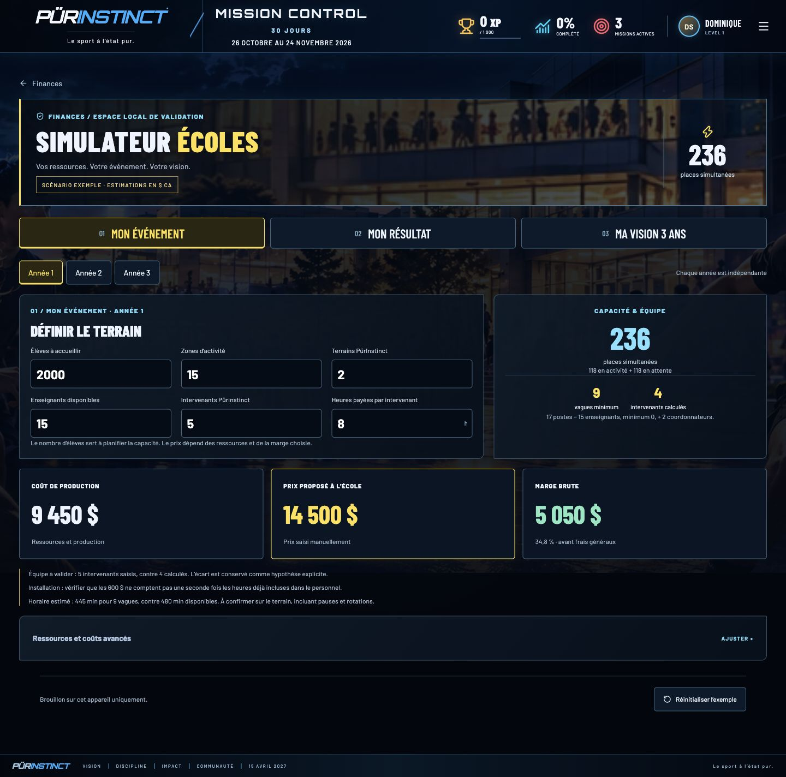
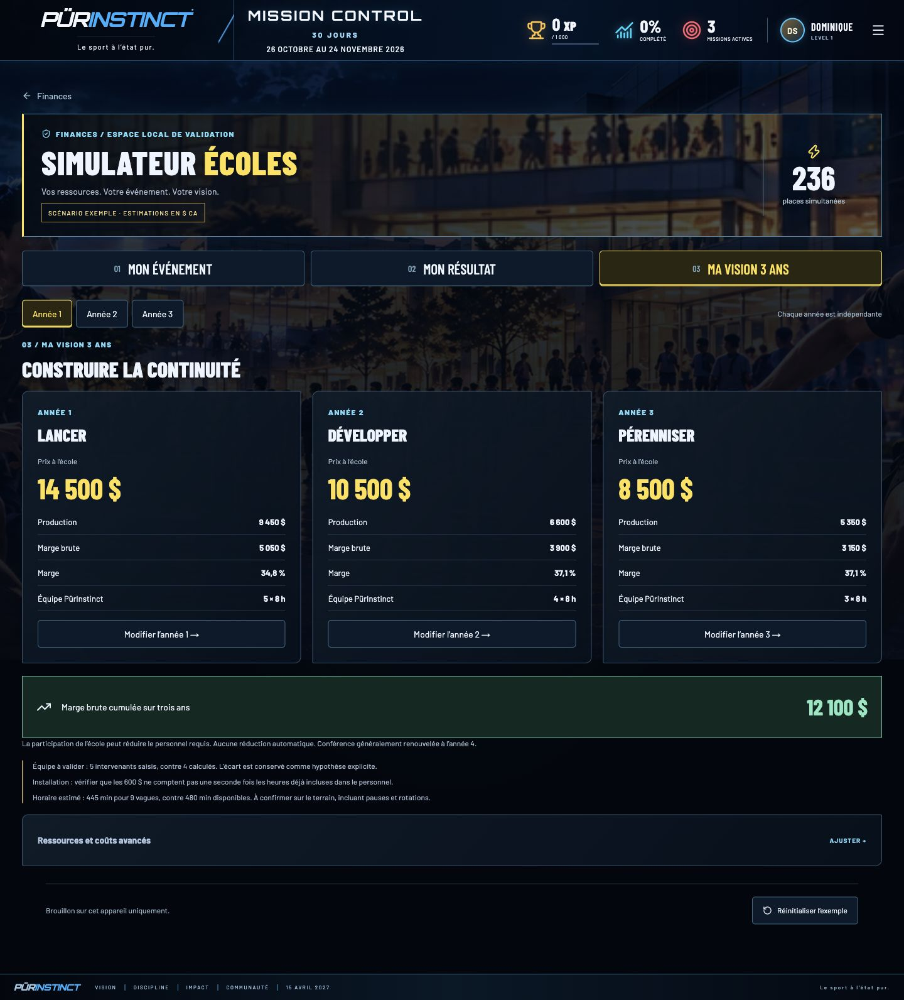
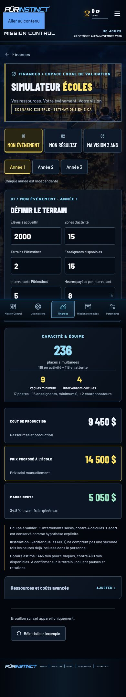
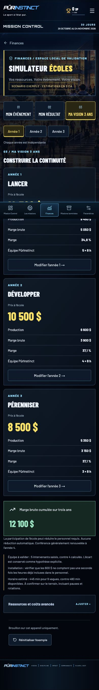

# Validation du simulateur Écoles

Scénario exemple uniquement, sans données financières de clients.

- 31 tests passent, dont les cinq tests du modèle financier et de la porte serveur.
- `npm run lint`, `npm run typecheck`, `npm run build` passent.
- Les neuf postes et les totaux des trois années correspondent à SCENARIOS.csv.
- Navigation, effectifs, coûts horaires, prix libre, prix nul, cible à 100 %,
  indépendance des années, recharge et confirmation clavier vérifiés dans le navigateur.
- Rendu vérifié à 1440, 768, 390 et 320 pixels.
- Build de production local démarré avec `SCHOOL_SIMULATOR_LOCAL=1` :
  `/finances`, `/finances/simulateur-ecoles` et une requête RSC refusées (404),
  sans contenu financier rendu.
- Accueil, archive, paramètres, mission V1 et projet Vanier répondent 200.
- Configuration Vercel consultée : SSO activé, mode `all_except_custom_domains`.
  La porte applicative refuse aussi toutes les previews Vercel. Aucun accès
  hébergé au simulateur n’est activé.

L’authentification hébergée reste un préalable à une future activation en ligne.
Le présent module est disponible en validation locale seulement. Les brouillons
sont propres à l’appareil, sans synchronisation entre onglets.

Les captures montrent l’exemple de référence après réinitialisation confirmée.

